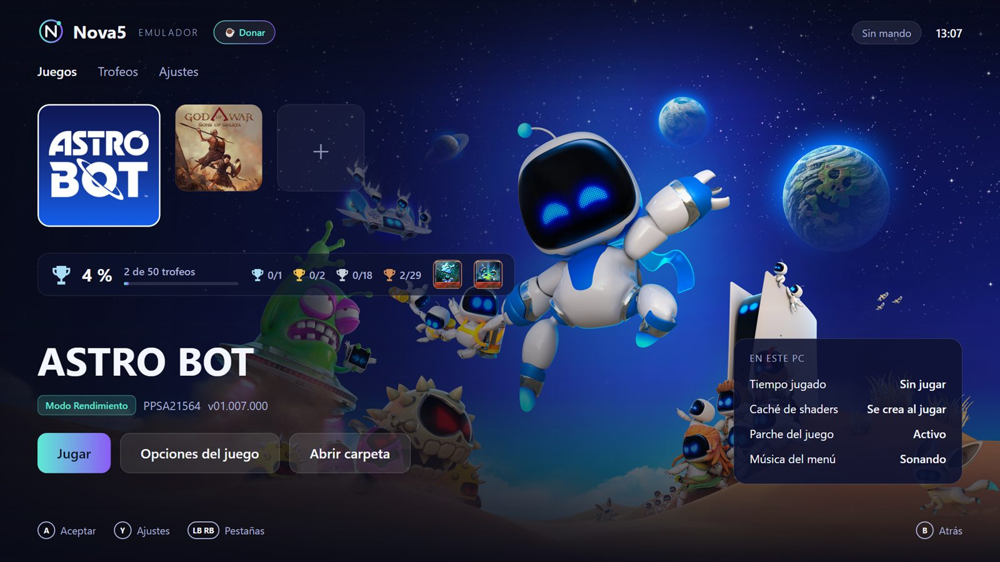

  

<h1 align="center">Nova5</h1>

  Emulador de PS5 de código abierto para PC, con un lanzador de estilo consola. 
  <a href="https://nova5emu.github.io/nova5/">Web oficial</a> ·
  <a href="https://github.com/nova5emu/nova5/releases/latest">Descargar</a> ·
  <a href="https://ko-fi.com/nova5emu">Donar en Ko-fi</a> ·
  <a href="LICENSE">GPL-2.0</a>

  

## Qué es

Nova5 combina el emulador [KytyPS5](https://github.com/KytyPS5/KytyPS5), con mejoras de rendimiento
y correcciones propias, y un lanzador nuevo pensado para jugar desde el sofá:

- Carátulas y fondos en alta resolución de cada juego, con transiciones suaves.
- La música de menú de cada juego al seleccionarlo (`sce_sys/snd0.at9`, decodificada con LibAtrac9).
- Control total con mando (SDL3) o teclado.
- Configuración automática en el primer arranque: detecta el procesador y activa la compatibilidad de CPU solo si hace falta.
- Instalador para Windows que no requiere permisos de administrador.

Nova5 no incluye juegos, firmware ni claves. Funciona con juegos extraídos de copias que poseas legalmente.

## Estado

La emulación de PS5 es experimental. Juegos comprobados por nosotros:

| Juego | Estado | Notas |
|---|---|---|
| God of War Sons of Sparta | Jugable | 60 FPS. |
| Astro Bot | En juego | 50–60 FPS en el inicio y el mapa de la galaxia; Sky Garden se juega con el cielo correcto a unos 19 FPS (i9-14900KF y RTX 4070 SUPER). Guarda y carga partidas. |
| Demon's Souls | En juego | 60 FPS a velocidad normal en el tutorial. |
| Marvel's Wolverine | Sin comprobar | Aún no probado con el motor de la versión 0.7.0. |

Vídeos de gameplay real en la [web](https://nova5emu.github.io/nova5/gameplay.html).

## Requisitos

- Windows 10 u 11 de 64 bits.
- Gráfica con Vulkan 1.3 y controladores actualizados.
- 16 GB de RAM o más.

## Compilar

- Emulador: `build-windows.cmd` (CMake, clang-cl y Ninja en Windows; requisitos en el propio archivo).
- Lanzador: `src/nova5` (Avalonia, .NET 10). `dotnet publish src/nova5 -c Release -o <carpeta del emulador>`.
- Instalador: `src/nova5/package/build-package.ps1` genera `_Build/package/Nova5-Setup.exe` con Inno Setup 6.
- Web: carpeta `website/`, publicada con GitHub Pages.

## Donar

Nova5 es y seguirá siendo gratis. Si quieres ayudar a que avance más rápido, puedes donar en
[Ko-fi](https://ko-fi.com/nova5emu) ☕. Las aportaciones son voluntarias y no dan acceso a nada extra:
se usan para hardware de pruebas y horas de desarrollo.

## Licencia y créditos

Nova5 se distribuye bajo la GPL-2.0, igual que KytyPS5. El Kyty original está bajo licencia MIT
(`LICENSES/`) y los componentes de terceros conservan sus licencias (`3rdparty/`).
Gracias al equipo y la comunidad de KytyPS5, sobre cuyo trabajo se construye este proyecto.

Nova5 no está afiliado, respaldado ni patrocinado por Sony Interactive Entertainment.
"PlayStation" y "PS5" son marcas de sus respectivos dueños.
